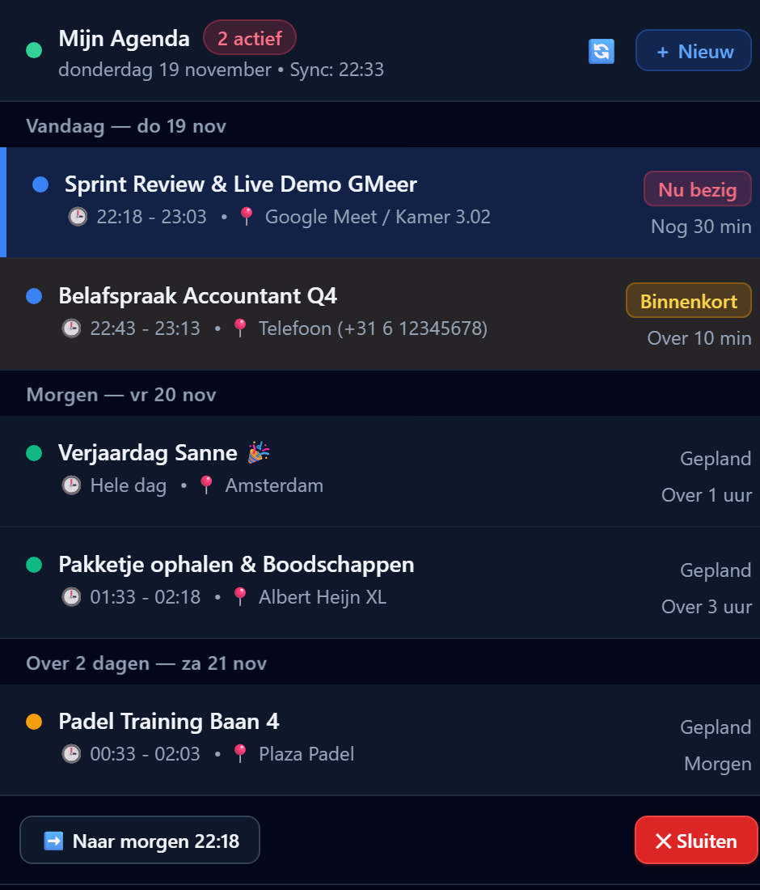
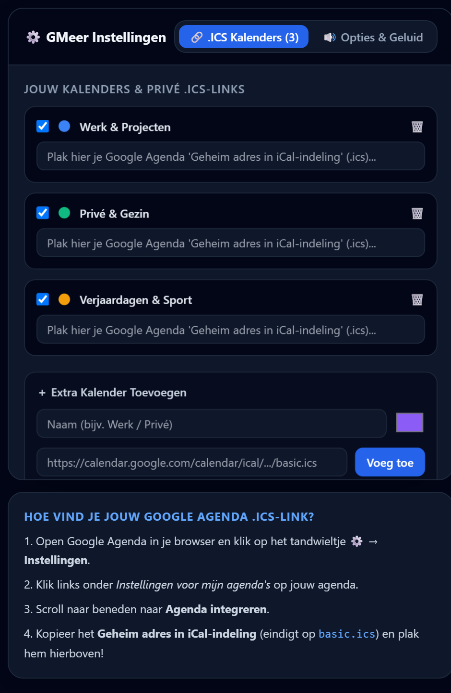

# GMeer - A GMinder fork

Fork of [milowg/GMinder](https://github.com/milowg/GMinder).

Because milowg stopped working on it in 2017 and it started to have some bugs, I rewrote it in Rust with Tauri (instead of the previous .NET 4.x) and also updated all necessary dependencies (Rust crates & npm). Further, I made it a bit more modern, with icons instead of buttons.

<p align="center">
  
  &nbsp;&nbsp;
  
</p>

<sub>Screenshots show demo data (Dutch interface; English is also available).</sub>

## Features

- Lives in the Windows system tray: **left-click** shows your agenda, **right-click** opens the calendar settings and options
- Reads your Google Calendar via its secret iCal (`.ics`) address and syncs automatically
- Reminders before an appointment starts, with optional sound and speech
- **Double-click** an appointment to open it in Google Calendar
- **Move to tomorrow** (same time) and **quick add** with a compact date/time picker, written directly to Google Calendar
- Click outside the window to hide it to the tray again (can be turned off)
- English and Dutch: follows the Windows language, switchable under *Opties / Options*
- Starts with Windows (can be turned off), only one instance at a time

## Installation

1. Download `GMeer_<version>_x64-setup.exe` from the [latest release](https://github.com/mikkie71/GMeer/releases/latest) (Windows 10/11, x64).
2. Run it and choose an install folder. GMeer is installed for the current user (no admin rights needed) and starts with Windows.
3. Windows SmartScreen may warn because the installer is not code-signed: click **More info → Run anyway**.

New Windows tray icons are often hidden behind the **^** arrow next to the clock. To keep GMeer visible: *Settings → Personalization → Taskbar → Other system tray icons → GMeer on*.

Uninstall via *Settings → Apps*. Your settings are kept unless you tick the option to delete app data.

## Setup

### 1. Add your calendar (read)

1. Open [Google Calendar](https://calendar.google.com) → ⚙️ **Settings**.
2. Under *Settings for my calendars*, click your calendar and scroll to **Integrate calendar**.
3. Copy the **Secret address in iCal format** (ends with `basic.ics`).
4. In GMeer: right-click the tray icon → **.ICS Kalenders** → paste the link.

Keep this link private: anyone who has it can read your calendar.

### 2. Connect Google (optional, for moving and adding appointments)

The `.ics` link is read-only. To use **Naar morgen** (move to tomorrow) and **+ Nieuw** (quick add), GMeer needs one-time permission via the Google Calendar API. You use your own OAuth client:

1. In the [Google Cloud Console](https://console.cloud.google.com), create a project and enable the **Google Calendar API**.
2. Configure the **OAuth consent screen**:
   - Google Workspace accounts: choose **Internal**.
   - Personal accounts: choose **External** and click **Publish app**. In *Testing* mode Google expires the permission after 7 days.
3. Under **Credentials**, create an **OAuth client ID** of type **Desktop app**.
4. In GMeer: right-click the tray icon → **Opties** → paste the Client ID and Client secret → **Koppelen met Google**, and approve in the browser.

The connection is stored in `%APPDATA%\nl.mikkie.gmeer\google.json` on your own PC. Changes are made without sending email notifications to guests.

## Building from source

Requirements:

- [Rust](https://rustup.rs) with the `stable-x86_64-pc-windows-gnu` toolchain
- [Node.js](https://nodejs.org) 20+
- MinGW-w64 (WinLibs): `winget install BrechtSanders.WinLibs.POSIX.UCRT`  
  If installed elsewhere, set the `MINGW_BIN` environment variable to its `bin` folder.

```bash
npm install
npx tauri build
```

The installer is written to `src-tauri/target/release/bundle/nsis/`. During development, `npx tauri dev` runs the app with live reload.

The icon is generated by `python scripts/make_icon.py` (requires Pillow).

## License

BSD 2-Clause, like the original GMinder. See [LICENSE](LICENSE).
